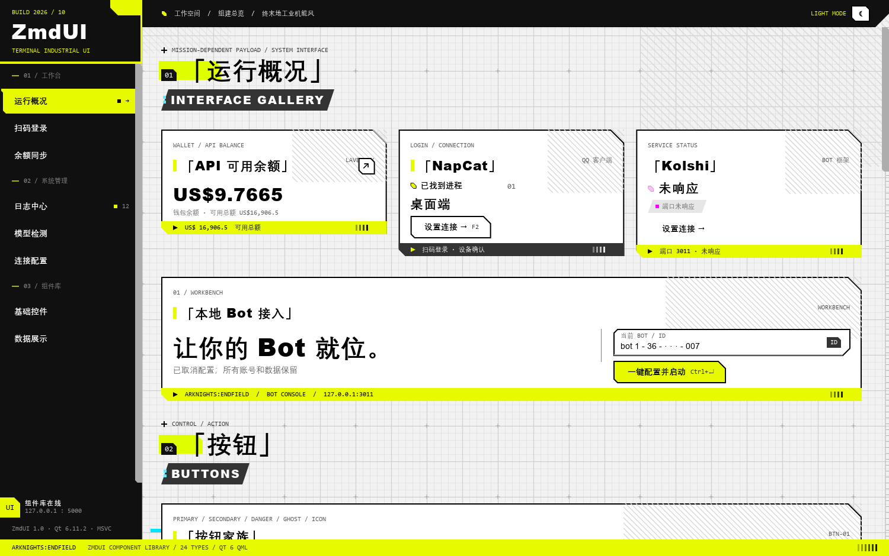
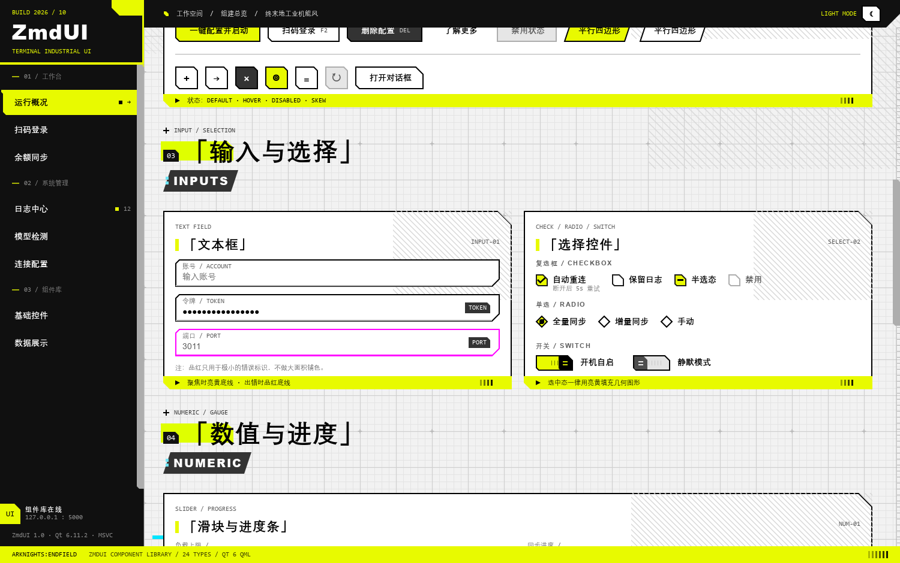
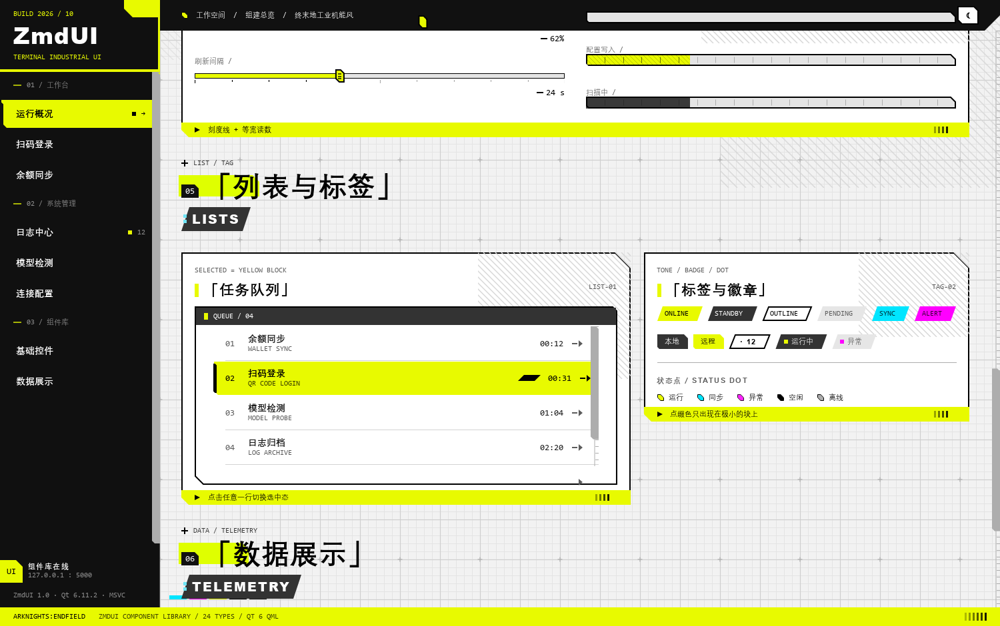
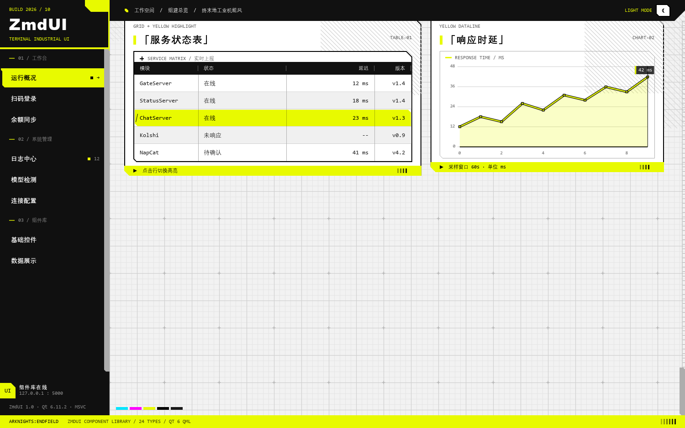
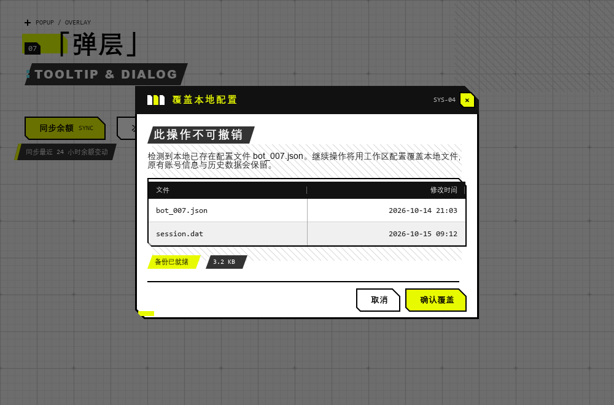
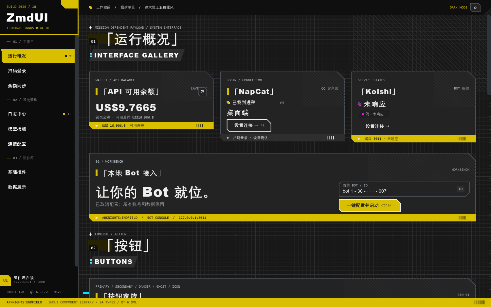
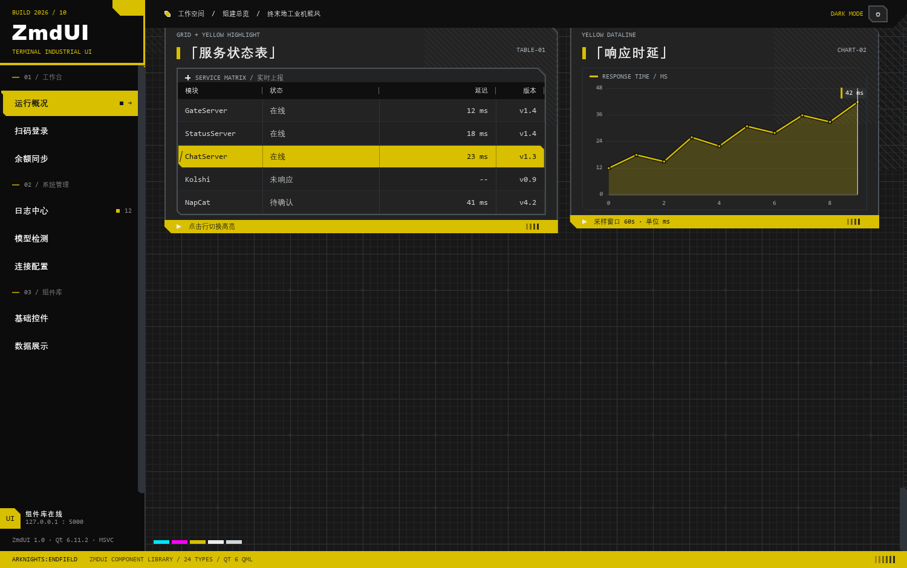

# ZmdUI · 终末地工业机能风 QML 组件库

一套基于 **Qt 6 + QML** 的桌面端 UI 组件库，视觉语言取自《明日方舟：终末地》的工业机能风：
亮白底 / 荧光黄 / 纯黑三色硬碰硬，斜切角代替圆角，工程网格铺底，超粗标题压场，
**零图片资源**（网格、斜线纹理、斜切、图标全部用 `Shape` / `Canvas` 画出来）。

纯 QML 实现，`import ZmdUI 1.0` 即用，不引入任何第三方库。



---

## 特性

| | |
| --- | --- |
| **25 个类型** | 1 个主题单例 + 4 个绘制图元 + 20 个控件，每个组件一个独立 `.qml` 文件 |
| **零图片** | 网格背景、斜线纹理、斜切角、平行四边形、对勾、三角箭头全部是 `Shape` 路径或 `Canvas` 绘制 |
| **一键换肤** | `Theme.mode = Theme.Mode.Dark` 即整体切换亮 / 暗主题，组件零改动 |
| **不用默认样式** | 全部继承 `QtQuick.Controls.Basic` 的抽象控件并**替换掉 `background` / `contentItem` / `indicator`**，不存在平台原生样式残留 |
| **高 DPI** | 尺寸一律用逻辑像素，Qt 6 自动按 `devicePixelRatio` 缩放；构建时锁定 `PassThrough` 舍入策略，1.25x / 1.5x 下线条不糊 |
| **可验证** | 附带无头冒烟测试（离屏渲染 + 抓图）与局部放大工具，改完能自证渲染结果 |








---

## 目录结构

```text
ZmdUI/
├── CMakeLists.txt              # 构建脚本（Qt 6.5+）
├── README.md
├── src/
│   └── main.cpp                # 应用入口：Basic 样式 + 高 DPI + qrc 导入路径
├── resources/
│   └── qml.qrc                 # 资源清单，资源路径与磁盘结构一致（:/qml/...）
├── qml/
│   ├── main.qml                # 演示程序：窗口壳
│   ├── DemoContent.qml         # 演示内容：六大区块，覆盖全部组件
│   └── ZmdUI/                  # ← 组件库本体（模块 URI: ZmdUI 1.0）
│       ├── qmldir
│       ├── Theme.qml           # 主题单例
│       ├── ZCutRect.qml        # 斜切角矩形图元
│       ├── ZSkewRect.qml       # 平行四边形图元
│       ├── ZHatchPattern.qml   # 斜线纹理
│       ├── ZGridBackground.qml # 工程网格背景
│       ├── ZButton.qml  ZIconButton.qml  ZTextField.qml
│       ├── ZCheckBox.qml  ZRadioButton.qml  ZSwitch.qml
│       ├── ZSlider.qml  ZProgressBar.qml
│       ├── ZPanel.qml  ZSectionTitle.qml  ZTag.qml  ZStatusDot.qml
│       ├── ZListItem.qml  ZListView.qml  ZScrollBar.qml  ZToolTip.qml
│       └── ZDialog.qml  ZSideBar.qml  ZTable.qml  ZLineChart.qml
├── docs/
│   ├── ZmdUI_组件库文档.md      # 全部源码汇总（由 tools/gen_docs.py 生成）
│   ├── verification.md         # 验证记录（真实命令与输出）
│   └── screenshots/
└── tools/
    ├── gen_docs.py             # 文档生成
    ├── smoke.qml               # 无头冒烟测试
    ├── smoke_scroll.qml        # 分段滚动截图
    ├── probe_popup.qml         # 弹层探针
    └── crop.qml                # 局部放大核对
```

分层规则：**主题层**（`Theme`）→ **图元层**（4 个 Shape/Canvas 图元）→ **组件层**（20 个控件）。
组件只从 `Theme` 取值、只用图元绘制 —— 换主题不用改组件，换视觉不用改业务。

---

## 快速开始

### 方式一：当独立程序跑（含演示应用）

工程是跨平台的（Windows / Linux / macOS），编译器 MSVC / MinGW / GCC / Clang 都支持。
**一个编译器一个构建目录**，别混用。

| 环境 | 配置命令 |
| --- | --- |
| MSVC | `cmake -S . -B build -G Ninja -DCMAKE_BUILD_TYPE=Release -DCMAKE_PREFIX_PATH="C:/Qt/6.8.0/msvc2022_64"` |
| MinGW | `cmake -S . -B build-mingw -G Ninja -DCMAKE_BUILD_TYPE=Release -DCMAKE_CXX_COMPILER="C:/Qt/Tools/mingw1310_64/bin/g++.exe" -DCMAKE_PREFIX_PATH="C:/Qt/6.8.0/mingw_64"` |
| GCC / Clang | `cmake -S . -B build -DCMAKE_BUILD_TYPE=Release`（Qt 用系统包或 `-DCMAKE_PREFIX_PATH`） |

```bash
cmake --build build            # 或 cmake --build build-mingw
./build/ZmdUIDemo              # Ninja 单配置：产物直接在构建根目录
```

可选开关：

| 开关 | 默认 | 说明 |
| --- | --- | --- |
| `ZMDUI_CONSOLE` | OFF | Windows 下保留控制台窗口（调试时看 qDebug / QML 警告） |
| `ZMDUI_DEPLOY_TO_BUILD_DIR` | ON | Windows 下构建后把 Qt 运行时部署到构建目录（见下） |
| `ZMDUI_STATIC_MINGW_RUNTIME` | ON | MinGW 下静态链接 libgcc / libstdc++（见下） |
| `ZMDUI_WARNINGS` | ON | MSVC 用 `/W4 /permissive-`，其它编译器用 `-Wall -Wextra` |

### 打包发布（三平台各自一条命令）

```bash
cmake --install build --prefix dist     # Windows 走 windeployqt，macOS 走 macdeployqt
```

产出的 `dist/` 是自包含的（Qt DLL + QML 插件 + 平台插件 + 翻译），可直接拷到干净机器运行。
**注意**：本工程用的是普通 `.qrc` 而不是 `qt_add_qml_module`，所以 CMake 里必须显式把 QML 目录
喂给部署工具（`DEPLOY_TOOL_OPTIONS --qmldir <目录>`）。漏掉这一步会出现"Qt DLL 都在、
`qml/` 目录却是空的"，拷到干净机器上插件加载不到、程序起不来。

### 工程怎么自己找到 Qt

`find_package(Qt6)` 需要知道 Qt 在哪，但 IDE 生成的 profile 常常什么都不传
（CLion 的默认命令就只有 `-G Ninja` + 构建目录），于是报
`Could not find a package configuration file provided by Qt6`。

所以 CMake 里做了一层自动探测，**按优先级依次尝试**：

1. 显式指定：`-DZMDUI_QT_ROOT=` / `-DQt6_DIR=` / `-DCMAKE_PREFIX_PATH=`
2. 环境变量：`QTDIR` / `QT_DIR` / `Qt6_DIR`
3. 扫常见安装位置：`C:/Qt`、`C:/dev/Qt`、`D:/Qt`、`~/Qt`、`/opt/Qt`、`/usr/local/Qt`……
   —— **按当前编译器家族挑套件**（MinGW 找 `mingw_*`，MSVC 找 `msvc*`，macOS 找 `macos`／`clang_64`），
   同族里优先版本号更高的。

配置时会打印实际用到的套件，方便确认：

```text
-- ZmdUI: 未指定 Qt 路径，自动探测到 C:/dev/Qt/6.11.2/mingw_64
-- ZmdUI: 使用 Qt 6.11.2 @ C:/dev/Qt/6.11.2/mingw_64
-- ZmdUI: 编译器 GNU 13.1.0
```

自动探测只是"帮你填搜索提示"，找不到照样会给出明确报错，不会静默用错套件。

### 构建目录开箱可运行（Windows）

Windows 没有 RPATH 这种东西，DLL 只从「exe 所在目录 / 系统目录 / 当前目录 / PATH」找。
刚编出来的 exe 旁边没有 Qt6Core.dll、PATH 里也没有 Qt 的 bin 时，双击或者直接从 IDE Run
会立刻以 **0xC0000135（STATUS_DLL_NOT_FOUND）** 退出 —— 这个报错跟代码无关，纯粹是找不到 DLL。

所以 Windows 上默认开启**构建目录自包含**：构建后用 windeployqt 把运行时依赖
（Qt DLL + QML 插件 + 平台插件 + 编译器运行库）拷到 exe 旁边，构建产物直接能跑，
CLion 的 Run 按钮也能用。

```bash
-DZMDUI_DEPLOY_TO_BUILD_DIR=OFF     # 不想让构建目录多出几十 MB 就关掉，
                                    # 然后自己把 Qt 的 bin 加进 PATH
```

两个细节：

- **只部署 `qwindows` 平台插件**（真机用的那个）。所以本机用 `QT_QPA_PLATFORM=offscreen`
  做无头测试时，需要自己把 Qt 的 `qoffscreen.dll` 拷进 `platforms/`。
- **Debug 构建不一定用 Debug 版 Qt**：很多官方二进制套件（比如 MinGW 那套）只带
  Release 的 `Qt6Core.dll`，没有 `Qt6Cored.dll`。这种情况下 Debug 构建链接的也是 Release Qt，
  部署必须给 `--release`；CMake 会自动探测套件里有没有 `Qt6Cored.dll` 来决定，
  不用你操心。

### 在 CLion / Qt Creator 里打开

**CLion**：`Settings → Build, Execution, Deployment → CMake`，
把 profile 的 **Toolchain 选成对应的 MinGW 或 MSVC**，CMake options 一般留空即可。
万一自动探测不到，再补一行：

```text
-DCMAKE_PREFIX_PATH="C:/Qt/6.8.0/mingw_64"
```

> **工具链和 Qt 套件必须同族**：MinGW 工具链配 `mingw_64` 的 Qt，MSVC 配 `msvc2022_64`。
> 配错时 CMake 会在配置阶段直接拦下来给人话错误（而不是等链接时抛一串
> `file format not recognized`）：
>
> ```text
> CMake Error: 编译器与 Qt 套件不匹配：
>   当前编译器：MinGW (GNU 13.1.0)
>   找到的 Qt ：C:/Qt/6.8.0/msvc2022_64
> ```
>
> CLion 的构建目录（`cmake-build-*/`）已经在 `.gitignore` 里。

**Qt Creator**：`File → Open File or Project` 打开 `CMakeLists.txt`，选对 kit 即可。

### MinGW 的两个坑（已在 CMake 里处理）

1. **运行库 DLL**：MinGW 编出来的 exe 依赖 `libgcc_s_*.dll` / `libstdc++-6.dll` /
   `libwinpthread-1.dll`，这三个不在 Qt 里。CMake 里做了两手：
   `-static-libgcc -static-libstdc++` 静态链掉前两个（省 2.3MB），
   `libwinpthread-1.dll`（线程模型 DLL）在构建后自动拷到 exe 旁边。
   可以用 `objdump -p ZmdUIDemo.exe | grep "DLL Name"` 复核导入表。
2. **不要关 `CMAKE_CXX_EXTENSIONS`**：Qt 自己就是用 `gnu++17` 编的，
   MinGW 下改成 `-std=c++17` 会引入 `__STRICT_ANSI__` 差异，属于自找麻烦。

### 方式二：不编译 C++，直接用 QML 运行时预览

```bash
cd ZmdUI
qml.exe -I qml qml/main.qml      # Linux/macOS 上是 qml
```

`-I qml` 很关键：`main.qml` 里的 `import ZmdUI 1.0` 靠它解析到 `qml/ZmdUI/qmldir`。

### 方式三：集成进已有 Qt 工程（推荐）

1. 把 `qml/ZmdUI/` 整个目录拷到你工程的 QML 目录下，例如 `qml/ZmdUI/`。
2. 在 `main.cpp` 里加一条导入路径，并强制 Basic 样式：

   ```cpp
   #include <QQuickStyle>
   // ...
   QQuickStyle::setStyle(QStringLiteral("Basic"));   // 必须，否则平台样式会掺进来
   QQmlApplicationEngine engine;
   engine.addImportPath(QStringLiteral("qrc:/qml")); // 与 qrc 里的路径对应
   ```

3. 把 `qml/ZmdUI/**` 加进你的 `.qrc`（保持 `:/qml/ZmdUI/...` 的路径结构），
   或在运行时用 `engine.addImportPath("文件系统路径")` 直接指到磁盘目录。
4. 任意 `.qml` 里：

   ```qml
   import ZmdUI 1.0

   ZPanel {
       width: 420
       title: "运行概况"
       subtitle: "SERVICE STATUS"
       footerText: "ARKNIGHTS:ENDFIELD / CONSOLE"
       ZButton { text: "一键配置并启动" }
   }
   ```

> ⚠️ 只拷贝单个组件文件是不够的：组件之间靠同目录隐式导入互相引用，
> 且 `qmldir` 里声明了 `Theme` 单例，**整个 `ZmdUI/` 目录必须完整保留**。

---

## 主题与设计令牌

所有颜色、字体、尺寸、动画都在 `qml/ZmdUI/Theme.qml` 里，组件代码中不存在魔法数字。

```qml
// 切换暗色主题（默认浅色）
Theme.mode = Theme.Mode.Dark
Theme.mode = Theme.Mode.Light

// 以你的品牌色为基准改主题：只改这一个文件
readonly property color accent: "#DFFF00"     // 主强调色
readonly property color ink:    "#111111"     // 主文字 / 线条
readonly property color bg:     "#F4F4F4"     // 页面底色

// 整体密度：0.9 紧凑 / 1.0 标准 / 1.15 宽松
Theme.density = 0.9
```

**字体**：默认 `Microsoft YaHei UI`（正文）+ `Arial Black`（拉丁标题）+ `Consolas`（等宽说明）。
中文在 Windows 上只有 Regular/Bold 两档字重，标题直接用 `Font.Black`（落到 Bold）+ 收敛字距。

> 试过用 `Text.Outline` + 同色 `styleColor` 给中文标题"描边加粗"，**已废弃**：
> 40px 级别下描边会把「概」「况」这类字的字腔糊死，反而看不清。要更粗请换字体
> （如思源黑体 Heavy），改 `Theme.family` 即可，不要走描边这条路。

**尺寸**：一律逻辑像素。Qt 6 默认按 `devicePixelRatio` 把逻辑像素放大到物理像素，
所以主题里**没有**也不需要 `* dpr` 的乘法；`Theme.dp(v)` 只做密度换算并取整，
避免高 DPI 下出现 0.5 px 导致的边缘发虚。

**几何**：`Theme.cutSm/cutMd/cutLg` = 6/12/22，全库的斜切角都从这里取值；
`ZCutRect` 会把切角钳制在短边一半以内，防止路径自交。

---

## 组件速查

### 图元

| 类型 | 用途 | 关键属性 |
| --- | --- | --- |
| `ZCutRect` | 四角独立斜切的实心/描边矩形 | `color` `strokeColor` `strokeWidth` `cutTopLeft/TopRight/BottomLeft/BottomRight` |
| `ZSkewRect` | 平行四边形 | `color` `skew`（顶边右移量；`skew == width` 即直角三角形） |
| `ZHatchPattern` | 斜线纹理 / 斜线阴影 | `lineColor` `spacing` `lineWidth` `vertical` `cross` |
| `ZGridBackground` | 工程网格背景 + 十字星 | `bgColor` `minorStep` `majorStep` `showCross` `crossEvery` |

### 交互控件

| 类型 | 用途 | 关键属性 |
| --- | --- | --- |
| `ZButton` | 按钮 | `variant`(Primary/Secondary/Danger/Ghost) `mono` `skew` `tooltip` `stateDuration`；悬停有底色过渡 + 左竖条 0→5 长出的动画 |
| `ZIconButton` | 方形图标按钮 | `glyph` `tone` `tooltip` `source` |
| `ZTextField` | 输入框 | `label` `unit` `invalid`，聚焦亮黄底线 |
| `ZCheckBox` | 复选框 | `note` `indeterminate` |
| `ZRadioButton` | 单选 | 菱形指示器 |
| `ZSwitch` | 开关 | `note` `trackWidth` |
| `ZSlider` | 滑块 | `label` `valueSuffix` `showTicks` `decimals` |
| `ZProgressBar` | 进度条 | `label` `showValue` `showTicks` `indeterminate` |
| `ZToolTip` | 工具提示 | `text`（一般不用手写，给按钮设 `tooltip` 即可） |

### 容器与展示

| 类型 | 用途 | 关键属性 |
| --- | --- | --- |
| `ZPanel` | 卡片 / 面板 | `title` `subtitle` `tag` `eyebrow` `footerText` `footerTone` `hatch` `headerRight` |
| `ZSectionTitle` | 区块大标题 | `index` `eyebrow` `title` `subtitle` `highlight` |
| `ZTag` | 标签 / 徽章 | `tone` `skew` `dotColor` `mono` `uppercase` |
| `ZStatusDot` | 状态点 | `tone` `size` `blink` |
| `ZListItem` | 列表项 | `idx` `label` `description` `trailing` `selected` `accentWidth` |
| `ZListView` | 列表视图 | `model` `delegate` `currentIndex` `headerText` `frame`，`signal activated(int)` |
| `ZScrollBar` | 滚动条 | 挂在 `ScrollBar.vertical` 上 |
| `ZDialog` | 对话框 | `title` `code` `subtitle` `confirmText` `cancelText` `showFooter`，`signal confirmed()` |
| `ZSideBar` | 侧边导航 | `model` `currentIndex` `brand` `version` `navScrollBar`（关掉滚动条），`signal activated(int)` |
| `ZTable` | 数据表格 | `columns` `rows` `currentIndex` `caption` `footerText` `rowClickRobust`（行点击不被滚动容器抢走），`signal rowClicked(int)` |
| `ZLineChart` | 折线图 | `values` `labels` `caption` `suffix` `lineColor` `showDots` |

完整 API 注释在每个文件顶部的 `\qmltype` 文档块里（qmldoc 格式，Qt Creator / `qdoc` 可直接读）。

---

## 设计语言规范（实现即规范）

**配色**

| 角色 | 亮色主题 | 暗色主题 | 用途 |
| --- | --- | --- | --- |
| 页面底 | `#F2F2F2` | `#181818` | 网格画布 |
| 抬升面 | `#FFFFFF` | `#232323` | 卡片 / 面板 / 输入框（暗色下**比底色亮**） |
| 中间层 | `#E6E6E6` | `#1F1F1F` | 交替行、次级卡片 |
| 凹陷面 | `#E4E4E4` | `#101010` | 轨道、凹槽（比底色更暗，暗色下才有"凹进去"的层次） |
| 悬停面 | `#E9E9E9` | `#2C2C2C` | 悬停底（**方向相反**：亮色变暗、暗色变亮） |
| 主强调 | `#E8FA00` | `#D8BF00` | 高亮、装饰底边、选中态（暗色下压暗，见下） |
| 主强调·软 | `#DFFF00` | `#272302` | 标题高亮块（暗色下是深黄褐，浅字压上去才够对比） |
| 主文字 | `#000000` | `#EEEEEE` | 标题、正文 |
| 辅助文字 | `#5C5C5C` | `#A8B0B7` | 等宽说明文字（暗色用冷灰，中性灰在暗底上显脏） |
| 结构线 | `#000000` | `#4A5158` | 边框、分隔线（暗色**不用近白**） |
| 反相块 | `#111111` | `#0F0F0F` | 黑底白字的表头 / 编号块 / 对话框标题带 |
| 副标题底 | `#333333` | `#2E2E2E` | 黑底白字副标题块 |
| 点缀 | `#00E5FF` / `#FF00FF` | 同 | **只出现在 `ZStatusDot`、小色块这类极小面积上** |
| 淡青 | `#6FE4F5` | 同 | 黑底副标题块上的小装饰方块 |

### 暗色主题：三条硬规则

暗色**不是**把亮色反过来。参考 [fz.wiki](https://www.fz.wiki/) 的令牌关系重做了一版，
踩过的坑都固化成测试断言了（`tests/tst_hover.qml::test_darkThemeTokens`）：

| 规则 | 为什么 | 实现 |
| --- | --- | --- |
| **强调色要压暗** | 亮柠檬黄浮在暗底上非常刺眼，而且亮黄自带"发光"错觉 | `#E8FA00 → #D8BF00`，另给 `accentGlow` 用于细线小字 |
| **卡片要比底色亮** | 反过来（卡片比底暗）会把卡片画成"洞"而不是"板" | `bg #181818` → `surface #232323` |
| **结构线用中灰，绝不反相成近白** | 第一版把 `line` 反相成 `#EFEFEF`，每张卡镶一圈白边，夜里刺眼还丢了层级 | `#000000 → #4A5158` |

另外两条同源规则：

- **悬停方向相反**：亮色卡是白的，悬停要变暗；暗色卡是 `#232323`，悬停必须变**亮**
  （`surfaceHover`）。写死方向的悬停色在暗色下会"越悬停越黑"。
- **强调黄底上的文字/描边一律用 `textOnAccent`，不能用 `ink`**：暗色下 `ink` 是浅灰，
  压在压暗后的黄上等于看不见。受影响的：列表选中行文字、表格选中行、滑块把手描边、
  开关滑块、按钮左竖条。
- **反相块（黑底白字）必须恒为深色**：用 `inkBlock` 而不是 `ink`，
  否则暗色下表头会变成"浅底白字"，文字直接消失。

**几何**：能切角就不圆角（`cutTopRight` + `cutBottomLeft` 是最常用的组合）；
副标题、标签、选中高亮用平行四边形；面板右上角恒有一块斜线纹理区。
两条容易踩的规则，已写进对应组件注释：

- **贴边的装饰元素要"同角度同斜度"**：贴在斜切角 / 平行四边形边上的装饰条，
  必须和底板共用同一条斜边（`ZSwitch` 的滑块切角 = 轨道切角 − 内缩量；
  `ZToolTip` 的亮黄竖边用与底板完全相同的 `skew` 和高度），否则角上必然露缝或戳出形状外。
- **装饰不参与布局**：状态相关的装饰（如悬停时的左竖条）一律画在底板内部用 anchors 定位，
  宽度用动画从 0 长出来，绝不去改 `padding`。

**排版**：中文标题 `Font.Black` + 同色描边，配 `「」`；英文一律大写 + 加字距；
小字说明一律等宽字体（`SYSTEM INTERFACE` 那种感觉）。

---

## 验证

```bash
# 反相块体检：抓「主题反转后文字消失」这类问题（亮暗各一个方向）
python tools/check_inverse_blocks.py

# 行为测试：规则 / 属性 / 几何断言（CI 友好，退出码即结论）
qmltestrunner -input tests/tst_hover.qml -import qml

# 静态检查（0 错误）
qmllint -I qml qml/ZmdUI/*.qml qml/main.qml qml/DemoContent.qml

# 无头冒烟：离屏渲染 + 抓图，零 QML 警告才算过
export QT_QPA_PLATFORM=offscreen QT_QUICK_BACKEND=software
export QT_ASSUME_STDERR_HAS_CONSOLE=1 QT_QPA_FONTDIR=C:/Windows/Fonts
qml.exe -I qml tools/smoke.qml          # → SMOKE OK，退出码 0

qml.exe -I qml tools/smoke_scroll.qml   # 分段滚动，5 屏逐段核对
qml.exe -I qml tools/probe_popup.qml    # 强制展开工具提示 / 对话框
```

已跑通的结论、发现并修掉的 6 个问题、以及**没有验证到的部分**（交互态与暗色主题未逐帧核对），
都记在 [`docs/verification.md`](docs/verification.md) 里。

C++ 侧也已真编译真运行过（Qt 6.11.2 / MSVC 2022 x64 零警告，exe 离屏运行验证了
`qrc:/qml/main.qml` → `import ZmdUI 1.0` → `qmldir` 这条资源内模块解析链）。

---

## 放在 Flickable 里的注意事项

组件放进滚动容器（`Flickable` / `ListView`）时，有两类交互会被容器"抢走"，组件里已经做了处理：

| 现象 | 原因 | 处理 |
| --- | --- | --- |
| 表格行要点好几次才中一次 | 按下之后指针只要移动超过系统拖拽阈值（Windows 默认 10px），Flickable 就把这次按下当成滚动手势抢走，行收不到 `clicked` | `ZTable.rowClickRobust`（默认开）= `MouseArea.preventStealing`，按下即由行接管。代价是在表格上按住拖拽不再滚动页面（滚轮 / 滚动条不受影响），需要拖拽滚动就设 `false` |
| 滚动条盖住行右侧的编号 / 徽标 | Qt 给 Flickable 挂的滚动条是**浮在内容之上**的，不占位 | `ZSideBar` 始终预留 `navScrollBarReserve`（14px）；不需要滚动条可以直接 `navScrollBar: false` |

> 顺带一个查这类问题的通用手段：**命中测试**。`tools/probe_hittest.qml` 把目标元素的中心
> 换算到窗口坐标，再用 `childAt()` 从根一路往下钻，打印出该点最上层的元素链 ——
> 链子最后落在谁身上，谁就是接事件的那个，不用猜。本轮就是靠它排除了"被遮挡"这个可能。

## 已知限制

* 暗色主题是"可用且成套"的，但按需求以浅色为主设计，暗色下斜线纹理对比度经过调低处理，观感偏克制。
* `ZListView` 的默认委托只支持数组型模型（用 `modelData`）；如果用 `ListModel` 命名角色，请自己传 `delegate`。
* qmllint 的 79 条 `[unqualified]` 是委托访问 `index` / `modelData` 的固有提示，运行期无影响，
  详见 `docs/verification.md` 第 1 节。
* `ZLineChart` 面向"少量点"（< 200）的仪表盘场景，不是通用图表库。
